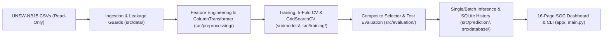
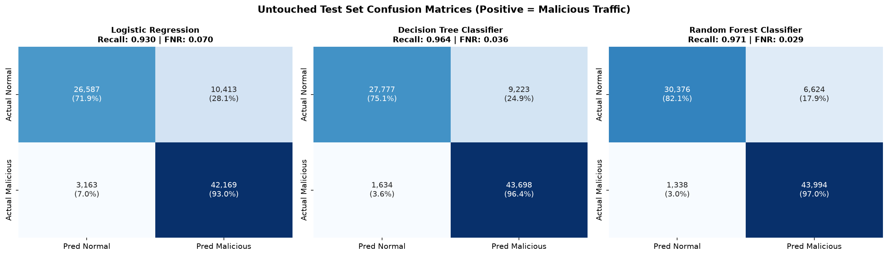
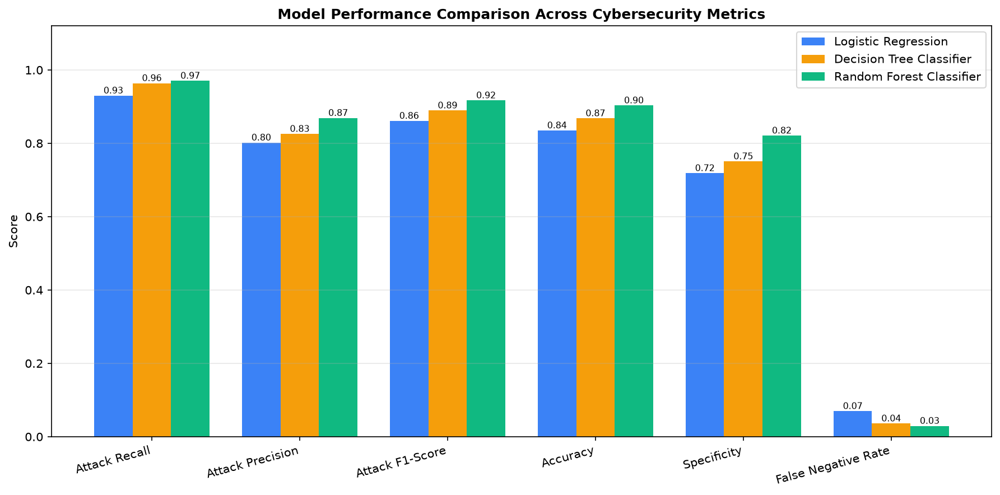
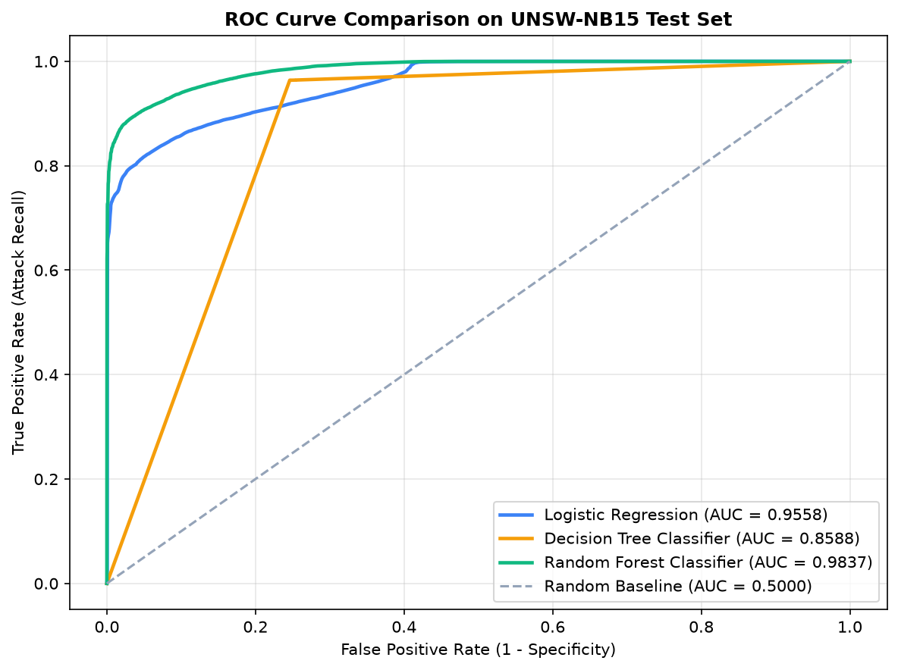
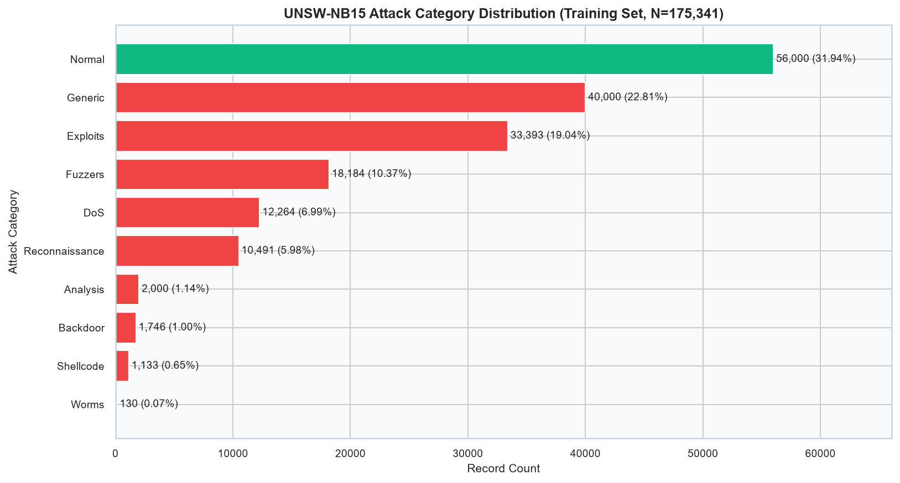
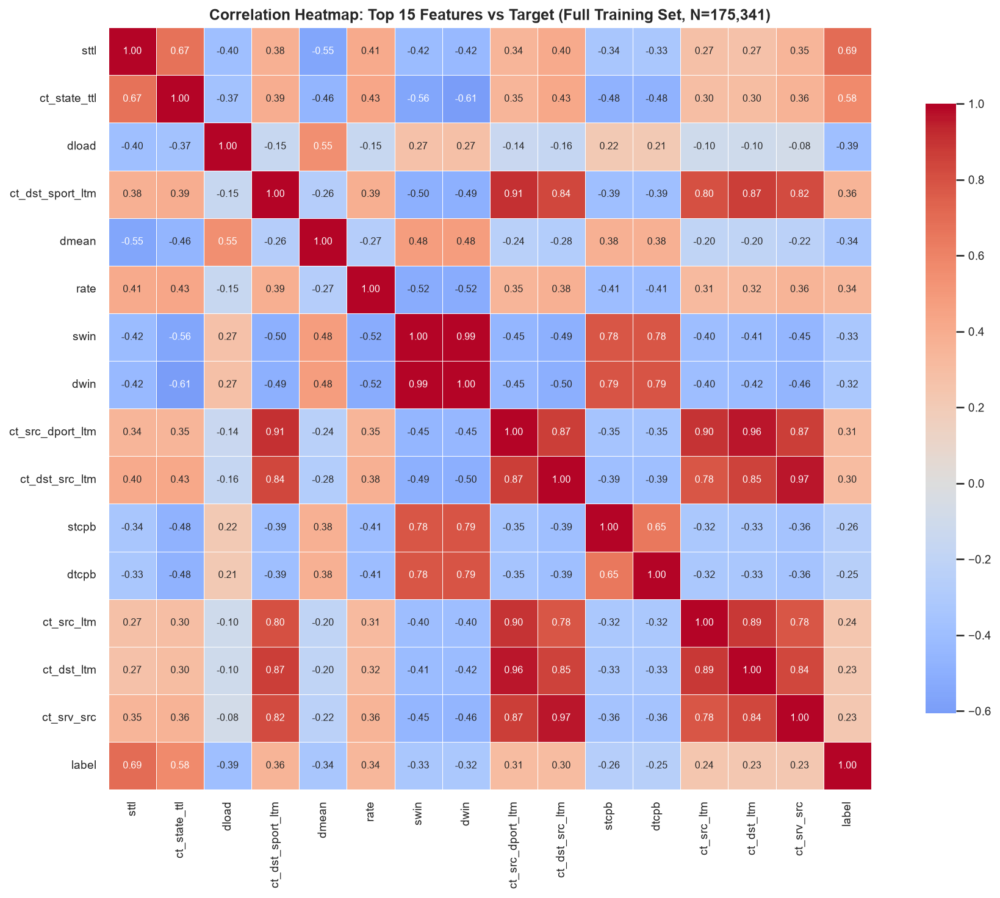
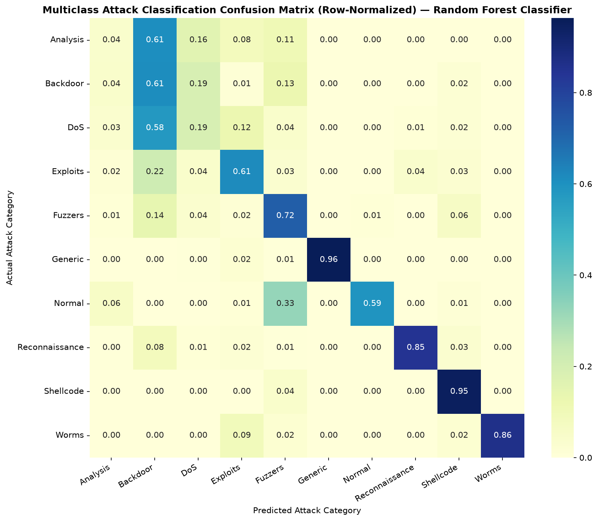

<div align="center">

<br />

# 🛡️ NETGUARD AI

### AI-Powered Network Intrusion Detection & Threat Classification System

[](https://www.python.org/)
[](https://scikit-learn.org/)
[](https://streamlit.io/)
[](#dataset-overview)
[](#evaluation--automated-testing)
[](LICENSE)

<p>
  <b>Leakage-Free Scikit-Learn Pipelines</b> &nbsp;·&nbsp;
  <b>5-Fold Stratified CV &amp; GridSearchCV</b> &nbsp;·&nbsp;
  <b>10-Class Threat Classification</b> &nbsp;·&nbsp;
  <b>16-Page Dark-Navy SOC Dashboard</b>
</p>

[Highlights](#key-highlights) &nbsp;|&nbsp;
[Architecture](#system-architecture) &nbsp;|&nbsp;
[Results](#experimental-results) &nbsp;|&nbsp;
[Visual Gallery](#visual-analytics-gallery) &nbsp;|&nbsp;
[Quickstart](#quickstart-and-cli) &nbsp;|&nbsp;
[Dashboard](#streamlit-command-center) &nbsp;|&nbsp;
[Structure](#project-structure) &nbsp;|&nbsp;
[Reports](#documentation-and-reports)

<br />

<table>
  <tr>
    <td align="center" width="25%">
      <h3>🎯 97.05%</h3>
      <sub><b>Attack Recall</b><br />Untouched UNSW-NB15 Test</sub>
    </td>
    <td align="center" width="25%">
      <h3>📈 0.9837</h3>
      <sub><b>ROC-AUC Score</b><br />PR-AUC: 0.9877 · F1: 0.9170</sub>
    </td>
    <td align="center" width="25%">
      <h3>🛡️ 2.95% FNR</h3>
      <sub><b>Missed-Attack Rate</b><br />Best Composite Score: 0.97131</sub>
    </td>
    <td align="center" width="25%">
      <h3>✅ 49 / 49</h3>
      <sub><b>Automated Pytest Suite</b><br />16 Streamlit Pages Verified</sub>
    </td>
  </tr>
</table>

</div>

---

> [!NOTE]
> **Operational Scope & Academic Context:** Built as an MCA Final-Year Project-Based Learning (PBL) system. **NETGUARD AI** is an offline dataset- and CSV-driven intrusion classification platform trained on **UNSW-NB15** flow records. It does **not** perform live NIC packet sniffing or inline firewall blocking, and automated ML predictions indicate statistical similarity rather than guaranteed proof of an actual cyberattack.

---

<a id="key-highlights"></a>
## Key Engineering Highlights

| Pillar | What Was Engineered |
| :--- | :--- |
| **Leakage-Free Pipeline** | Enforces strict exclusion of `id`, `attack_cat`, and `label` via `validate_no_target_leakage`; train/test partitions stay strictly isolated before final evaluation. |
| **Estimator-Aware Preprocessing** | Combines row-wise `NetworkFeatureEngineer` ratios with `ColumnTransformer`, applying `StandardScaler` exclusively for linear models and `OneHotEncoder(handle_unknown="ignore")` for unseen test states (`ACC`, `CLO`). |
| **Cybersecurity-First Model Selection** | Benchmarks **Logistic Regression**, **Decision Tree**, and **Random Forest** using validation-only composite scoring weighted toward Attack F1, ROC-AUC, Recall, and Precision rather than raw accuracy alone. |
| **Independent 10-Class Threat Engine** | Trains and evaluates an independent `attack_cat` Random Forest classifier across all 10 UNSW-NB15 categories without binary `label` leakage. |
| **Hardened Inference & Audit Log** | Enforces strict schema/numeric bounds, serialized `.joblib` path confinement, CSV formula-injection neutralization preserving negative values, and thread-safe parameterized `sqlite3` history logging. |
| **Modular App, CLI & Notebooks** | 16-page dark-navy Streamlit dashboard (`app/`), unified CLI runner (`main.py`), rotating logs (`logs/netguard.log`), and 6 interactive notebooks (`notebooks/01`–`06`). |

---

<a id="system-architecture"></a>
## System Architecture



<details>
<summary><strong>Explore Module Responsibilities Across Layers</strong></summary>

1. **Data & Validation (`src/data/loader.py`, `validator.py`, `eda.py`):** Resilient `utf-8`/`latin1` CSV loading, chunked iteration for large partitions, target-leakage assertions, and 12 automated statistical EDA analyses.
2. **Feature Engineering & Preprocessing (`src/preprocessing/pipeline.py`):** Median/mode imputation fitted solely on training folds plus non-leaking flow asymmetry ratios inside `NetworkFeatureEngineer`.
3. **Model Training & Optimization (`src/models/`, `src/training/`):** Unified estimators (`logistic_regression.py`, `decision_tree.py`, `random_forest.py`), 5-fold `StratifiedKFold` CV (`cross_validation.py`), `GridSearchCV` hyperparameter search (`tuning.py`), composite winner selector (`selector.py`), and independent multiclass training (`multiclass.py`).
4. **Evaluation, Inference & Storage (`src/evaluation/`, `src/prediction/`, `src/database/`):** Binary/multiclass metrics and chart generation, strict single-record and chunked batch CSV inference (`predict.py`), and parameterized SQLite history management (`db_manager.py`).
5. **Interface, Config & Observability (`app/`, `main.py`, `src/utils/`):** Multipage Streamlit app (`app/pages/`, `app/components/`, `app/styles/`), central path/env management (`config.py`), and rotating file/console logger (`logger.py`).

</details>

---

<a id="experimental-results"></a>
## Experimental Results

Models were trained and tuned strictly on the predefined UNSW-NB15 training set (`175,341` rows) and evaluated once against the untouched testing partition (`82,332` rows).

> [!IMPORTANT]
> **Production Champion — Random Forest Classifier** (`cybersecurity_composite` validation score: **`0.97131`**)
> Tuned hyperparameters: `n_estimators=100` · `max_depth=25` · `min_samples_split=2` · `min_samples_leaf=1`
> **Untouched Test Matrix (`N = 82,332`):** `TP = 43,994` · `TN = 30,376` · `FP = 6,624` · `FN = 1,338`

### 1. 5-Fold Stratified Cross-Validation (Training Partition: 175,341 Rows)

| Model | CV Recall (Mean ± Std) | CV Precision | CV F1 (Mean ± Std) | CV Accuracy | CV ROC-AUC | Runtime |
| :--- | :---: | :---: | :---: | :---: | :---: | ---: |
| **Random Forest Classifier** | **0.9531 ± 0.0012** | **0.9781** | **0.9654 ± 0.0011** | **0.9535** | **0.9938** | 192.57 s |
| Decision Tree Classifier | 0.9412 ± 0.0025 | 0.9774 | 0.9589 ± 0.0008 | 0.9451 | 0.9738 | 37.95 s |
| Logistic Regression | 0.9513 ± 0.0025 | 0.9495 | 0.9504 ± 0.0014 | 0.9324 | 0.9844 | 25.27 s |

### 2. Untouched Test Set Evaluation (82,332 Rows, Refitted on Full Training Set)

| Model | Accuracy | Precision | Attack Recall | Attack F1 | ROC-AUC | PR-AUC | Specificity | FNR | Latency (ms / 1k) |
| :--- | :---: | :---: | :---: | :---: | :---: | :---: | :---: | :---: | ---: |
| **Random Forest Classifier** | **0.9033** | **0.8691** | **0.9705** | **0.9170** | **0.9837** | **0.9877** | **0.8210** | **0.0295** | 9.295 |
| Decision Tree Classifier | 0.8681 | 0.8257 | 0.9640 | 0.8895 | 0.8588 | 0.8176 | 0.7507 | 0.0360 | 2.973 |
| Logistic Regression | 0.8351 | 0.8020 | 0.9302 | 0.8613 | 0.9558 | 0.9664 | 0.7186 | 0.0698 | 3.391 |

<details>
<summary><strong>View Tuned GridSearchCV Parameters &amp; Independent 10-Class Multiclass Summary</strong></summary>

- **Logistic Regression (`GridSearchCV` F1 = `0.9548`):** `C=10.0`, `class_weight=None`, `solver='liblinear'`
- **Decision Tree (`GridSearchCV` F1 = `0.9563`):** `criterion='entropy'`, `max_depth=None`, `min_samples_leaf=1`, `min_samples_split=2`
- **Random Forest (`GridSearchCV` F1 = `0.9632`):** `max_depth=25`, `min_samples_leaf=1`, `min_samples_split=2`, `n_estimators=100`

**Independent 10-Class `attack_cat` Classifier (`Normal`, `Generic`, `Exploits`, `Fuzzers`, `DoS`, `Reconnaissance`, `Analysis`, `Backdoor`, `Shellcode`, `Worms`):**
- **Winner:** Random Forest Classifier — `accuracy = 0.6774`, `macro_f1 = 0.5029`, `weighted_f1 = 0.7325`, `macro_recall = 0.6387`, `macro_precision = 0.5162`, inference latency `9.775 ms / 1k`.

</details>

---

<a id="visual-analytics-gallery"></a>
## Visual Analytics Gallery

Featured outputs generated directly by `python main.py run-eda`, `python main.py evaluate`, and `python main.py train-multiclass` (`reports/graphs/`):

<p align="center">
  
  <br />
  <sub><b>1. Untouched Test Confusion Matrices (N = 82,332):</b> Random Forest achieves 97.05% Attack Recall with only 1,338 False Negatives (2.95% FNR).</sub>
</p>

<table>
  <tr>
    <td width="50%" align="center" valign="top">
      
      <br />
      <sub><b>2. Cybersecurity Metrics Benchmark:</b> Side-by-side comparison across Recall, Precision, F1, Accuracy, Specificity, and FNR.</sub>
    </td>
    <td width="50%" align="center" valign="top">
      
      <br />
      <sub><b>3. ROC Curve Comparison:</b> Random Forest (AUC = 0.9837) vs Logistic Regression (0.9558) vs Decision Tree (0.8588).</sub>
    </td>
  </tr>
  <tr>
    <td width="50%" align="center" valign="top">
      
      <br />
      <sub><b>4. Training Attack Distribution (N = 175,341):</b> Record frequency across Normal traffic and 9 UNSW-NB15 attack families.</sub>
    </td>
    <td width="50%" align="center" valign="top">
      
      <br />
      <sub><b>5. Top-15 Feature Correlation Heatmap:</b> Highlights dominant target signals including <code>sttl</code> (0.69) and <code>ct_state_ttl</code> (0.58).</sub>
    </td>
  </tr>
</table>

<p align="center">
  
  <br />
  <sub><b>6. Independent 10-Class <code>attack_cat</code> Confusion Matrix (Row-Normalized):</b> Strong separation on Generic (96%), Shellcode (95%), Worms (86%), and Reconnaissance (85%).</sub>
</p>

---

<a id="dataset-overview"></a>
## UNSW-NB15 Dataset Overview

Source: **UNSW-NB15** *(Australian Centre for Cyber Security — Moustafa & Slay, 2015/2016)*. Original files are preserved read-only under `dataset/raw/`.

| Partition / Artifact | Path under `dataset/raw/` | Dimensions | Breakdown & Notes |
| :--- | :--- | :---: | :--- |
| **Predefined Training Set** | `csv/Training and Testing Sets/UNSW_NB15_training-set.csv` | `175,341 × 45` | `119,341` Malicious (`68.06%`), `56,000` Normal (`31.94%`), `0` nulls |
| **Predefined Testing Set** | `csv/Training and Testing Sets/UNSW_NB15_testing-set.csv` | `82,332 × 45` | `45,332` Malicious (`55.06%`), `37,000` Normal (`44.94%`), `0` nulls |
| **Raw Split Partitions** | `csv/UNSW-NB15_1.csv` – `4.csv` | `49` cols | Headerless raw splits preserved for chunked processing experiments |
| **Catalog & Docs** | `csv/NUSW-NB15_*.csv`, `documentation/*.pdf` | — | `latin1` feature descriptions (`45` mapped cols), GT & event references |

<details>
<summary><strong>Schema Anomalies &amp; Data Integrity Safeguards</strong></summary>

- **Explicit Placeholder Handling:** `service = '-'` occurs in `94,168` training flows and `47,153` test flows and is retained as a dedicated categorical level.
- **Unseen Categorical States:** Test records contain `state` values `['ACC', 'CLO']` absent during training; `OneHotEncoder(handle_unknown="ignore")` handles them cleanly without inference failures.
- **Duplicate Feature Signatures:** Dropping IP/port/timestamp columns in the predefined UNSW-NB15 benchmark introduces `229` conflicting feature groups in training and `8,541` overlapping signatures across splits.

</details>

---

## Technology Stack

| Layer | Verified Versions |
| :--- | :--- |
| **Runtime & VCS** | Python `3.12.10` (`>=3.12,<3.13`), Git |
| **Data & Numerics** | `pandas==3.1.1`, `numpy==2.5.5` |
| **ML & Persistence** | `scikit-learn==1.9.1`, `joblib==1.6.0` |
| **Visualization** | `matplotlib==3.11.2`, `seaborn==0.13.2`, `plotly==7.2.0` |
| **Dashboard & Storage** | `streamlit==1.67.0`, `sqlite3` (stdlib `3.49.1`) |
| **Testing** | `pytest==9.2.0` (`49` passing tests) |

---

<a id="quickstart-and-cli"></a>
## Quickstart & CLI Reference (Windows)

### 1. Setup & Environment Verification

```powershell
git clone https://github.com/Deb-Kumar/NETGUARD-AI.git
cd NETGUARD-AI

py -3.12 -m venv .venv
.venv\Scripts\activate
pip install -r requirements.txt

# Optional local overrides (NETGUARD_N_JOBS, NETGUARD_MAX_UPLOAD_MB, NETGUARD_LOG_LEVEL)
Copy-Item .env.example .env

# Verify Python 3.12 runtime, packages, and UNSW-NB15 dataset discovery
python main.py check-env
```

> [!TIP]
> Keep original UNSW-NB15 CSV files in `dataset/raw/csv/` (and `Training and Testing Sets/` inside it) and PDF docs in `dataset/raw/documentation/`. Legacy root and `dataset/raw/` locations remain supported fallbacks via `resolve_dataset_file()`.

### 2. Command Reference

| Command | Stage | Output Location |
| :--- | :--- | :--- |
| `python main.py inspect-data --save-report` | Dataset profiling & validation | `reports/experiments/dataset_inspection_report.json` |
| `python main.py run-eda` | Statistical & visual EDA | `reports/experiments/eda_summary.json` & `reports/graphs/01..08*.png` |
| `python main.py train` | Binary baseline + `class_weight` study | `models/binary/*.joblib` & `binary_training_summary.json` |
| `python main.py cross-validate --n-splits 5` | 5-Fold Stratified CV (`175,341` rows) | `models/metadata/cv_results.json` |
| `python main.py tune --cv-folds 5 --scoring f1 --max-tuning-samples 50000` | Bounded `GridSearchCV` + full refit | `models/metadata/tuning_results.json` & updated models |
| `python main.py select-best --strategy cybersecurity_composite` | Validation selection + final test eval | `models/binary/best_model.joblib` & `model_metadata.json` |
| `python main.py evaluate` | Untouched test eval + plots `09`–`12` | `binary_evaluation_results.json` & `reports/graphs/09..12*.png` |
| `python main.py train-multiclass` | Independent 10-class `attack_cat` pipeline | `models/multiclass/*.joblib` & `13_multiclass_confusion_matrix.png` |

<a id="evaluation--automated-testing"></a>
### 3. Run Automated Tests & Launch Dashboard

```powershell
# Execute complete 49-test suite (unit, integration, security, UI & E2E)
pytest

# Start the 16-page Streamlit cybersecurity dashboard
streamlit run app/app.py
```

---

<a id="streamlit-command-center"></a>
## Streamlit Command Center (16 Pages)

Organized into 5 operational workspaces using `st.navigation` in [app/app.py](app/app.py):

| Workspace Group | Available Pages |
| :--- | :--- |
| **Command Center** | `Dashboard` |
| **Dataset & Analytics** | `Dataset Management` · `Dataset Explorer` · `EDA and Analytics` · `Data Preprocessing` |
| **ML Pipeline** | `Model Training` · `Model Evaluation` · `Cross-Validation` · `Hyperparameter Tuning` · `Model Comparison` |
| **Threat Prediction** | `Single Traffic Prediction` · `Batch CSV Prediction` |
| **Logs, Reports & System** | `Prediction History` · `Reports and Exports` · `About Project` · `Settings` |

---

<a id="project-structure"></a>
## Project Structure

<details>
<summary><strong>Click to expand organized repository tree</strong></summary>

```text
NETGUARD-AI/
├── .streamlit/
│   └── config.toml                     # Dark-navy Streamlit theme configuration
├── app/
│   ├── __init__.py
│   ├── app.py                          # Multipage navigation & entrypoint
│   ├── components/
│   │   ├── __init__.py
│   │   ├── charts.py                   # Interactive Plotly visualizations
│   │   └── data_access.py              # Cached loaders for artifacts & sample splits
│   ├── pages/
│   │   ├── __init__.py
│   │   ├── batch_prediction.py         # Chunked CSV upload & threat classification
│   │   ├── cv_tuning_comparison.py     # CV, GridSearchCV & model ranking pages
│   │   ├── dashboard.py                # Executive cybersecurity summary view
│   │   ├── dataset_views.py            # Dataset management & interactive explorer
│   │   ├── eda_preprocessing.py        # Statistical EDA & preprocessing overview
│   │   ├── history_reports_system.py   # SQLite logs, exports, about & settings
│   │   ├── single_prediction.py        # Single flow telemetry predictor
│   │   └── training_eval_views.py      # Training & untouched test evaluation views
│   └── styles/
│       ├── __init__.py
│       └── theme.py                    # Custom cybersecurity CSS & palette tokens
├── database/                           # SQLite prediction history store (netguard_history.db)
├── dataset/
│   ├── processed/                      # Reserved for derived exports
│   └── raw/
│       ├── csv/                        # UNSW-NB15 CSV files & Training and Testing Sets/
│       └── documentation/              # UNSW-NB15 PDF documentation
├── logs/                               # Rotating runtime logs (netguard.log)
├── models/
│   ├── binary/                         # Serialized binary pipelines (.joblib)
│   ├── metadata/                       # Training, CV, tuning & evaluation JSON summaries
│   └── multiclass/                     # Serialized 10-class attack_cat models (.joblib)
├── notebooks/
│   ├── 01_dataset_analysis.ipynb
│   ├── 02_eda.ipynb
│   ├── 03_preprocessing.ipynb
│   ├── 04_model_training.ipynb
│   ├── 05_model_evaluation.ipynb
│   └── 06_hyperparameter_tuning.ipynb
├── reports/
│   ├── experiments/
│   │   ├── dataset_inspection_report.json
│   │   └── eda_summary.json
│   ├── final_audit/                    # Independent QA & security audit reports (00–22)
│   ├── graphs/                         # Generated EDA & evaluation PNGs (01–13)
│   ├── MCA_PBL_PROJECT_REPORT.md
│   ├── cleanup_inspection_report.md
│   └── project_structure_report.md
├── src/
│   ├── __init__.py
│   ├── data/                           # Loader, schema/leakage validator & EDA engine
│   ├── database/                       # Parameterized SQLite audit history manager (db_manager.py)
│   ├── evaluation/                     # Binary metrics, comparison tables & PNG plots
│   ├── models/                         # Logistic Regression, Decision Tree, Random Forest & loader
│   ├── prediction/                     # Single & batch inference engines + strict validators
│   ├── preprocessing/                  # NetworkFeatureEngineer & ColumnTransformer builders
│   ├── training/                       # Train, Stratified CV, GridSearchCV, selector & multiclass
│   └── utils/                          # Central paths/env config (config.py) & logging (logger.py)
├── tests/                              # 49 automated pytest checks (unit, security, UI, E2E)
├── .env.example
├── .gitignore
├── LICENSE
├── main.py                             # CLI orchestrator entrypoint
├── pyproject.toml
├── README.md
└── requirements.txt
```

</details>

---

<a id="documentation-and-reports"></a>
## Documentation & Visual Reports

- **Project Reports:**
  - [MCA Final-Year PBL Project Report](reports/MCA_PBL_PROJECT_REPORT.md)
  - [Project Structure Reorganization Report](reports/project_structure_report.md)
  - [Codebase Cleanup Inspection Report](reports/cleanup_inspection_report.md)
  - [Final Engineering Audit Suite (`reports/final_audit/`)](reports/final_audit/00_overall_audit_summary.md)

<details>
<summary><strong>Complete Catalog of 13 Generated Charts (<code>reports/graphs/</code>)</strong></summary>

| # | Chart File | Description |
| :-: | :--- | :--- |
| `01` | `01_binary_class_distribution.png` | Binary Normal vs Malicious class distribution |
| `02` | [`02_attack_category_distribution.png`](reports/graphs/02_attack_category_distribution.png) | 10-class `attack_cat` frequency distribution *(featured above)* |
| `03` | `03_protocol_distribution.png` | Top 10 network protocols by traffic class |
| `04` | `04_service_distribution.png` | Top services by traffic class (including `'-'`) |
| `05` | `05_numerical_feature_distributions.png` | `log1p` feature distributions (`30,000` stratified sample) |
| `06` | `06_outlier_boxplots.png` | Class-wise outlier box plots (`20,000` stratified sample) |
| `07` | [`07_correlation_heatmap.png`](reports/graphs/07_correlation_heatmap.png) | Correlation heatmap of top 15 features vs `label` *(featured above)* |
| `08` | `08_state_distribution.png` | Connection states across traffic classes |
| `09` | [`09_confusion_matrices_binary.png`](reports/graphs/09_confusion_matrices_binary.png) | Untouched test confusion matrices across all 3 models *(featured above)* |
| `10` | [`10_roc_curves_binary.png`](reports/graphs/10_roc_curves_binary.png) | Overlaid ROC curves across classifiers *(featured above)* |
| `11` | `11_pr_curves_binary.png` | Overlaid Precision-Recall curves across classifiers |
| `12` | [`12_model_metrics_comparison.png`](reports/graphs/12_model_metrics_comparison.png) | Multi-metric cybersecurity bar comparison *(featured above)* |
| `13` | [`13_multiclass_confusion_matrix.png`](reports/graphs/13_multiclass_confusion_matrix.png) | 10-class row-normalized confusion matrix *(featured above)* |

</details>

---

## Limitations & Roadmap

- **Known Limitations:**
  - Operates offline on UNSW-NB15 flow records and CSV uploads rather than live packet capture.
  - Predefined UNSW-NB15 splits omit IP/port/timestamp attributes, leaving overlapping feature signatures across minority attack families (`Analysis`, `Backdoor`, `DoS`).
- **Planned Enhancements:**
  - Streaming flow adapters (PCAP / Zeek / Argus ingestion)
  - Per-prediction SHAP / permutation feature attributions and concept-drift checks
  - Multi-user authentication and SIEM webhook alerting

---

<div align="center">

## License & Credits

Released under the **[MIT License](LICENSE)** · Dataset: **UNSW-NB15** *(Australian Centre for Cyber Security — Moustafa & Slay, 2015/2016)*

</div>