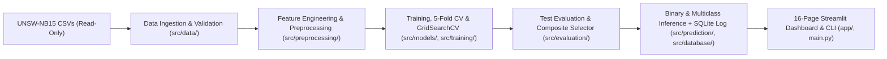

<div align="center">

# 🛡️ NETGUARD AI

### AI-Powered Network Intrusion Detection & Threat Classification System

[](https://www.python.org/)
[](https://scikit-learn.org/)
[](https://streamlit.io/)
[](#dataset-overview)
[](#evaluation--automated-testing)
[](LICENSE)

**End-to-end network flow intrusion detection combining leakage-free Scikit-learn pipelines, Stratified 5-Fold CV, `GridSearchCV` hyperparameter optimization, independent 10-class threat categorization, SQLite audit logging, and a 16-page dark-navy cybersecurity dashboard.**

[Highlights](#key-highlights) · [Architecture](#system-architecture) · [Results](#experimental-results) · [Quickstart](#installation--setup-windows) · [Dashboard](#streamlit-command-center-16-pages) · [Project Structure](#project-structure) · [Reports](#documentation--visual-reports)

</div>

---

> [!NOTE]
> **Operational Scope & Academic Context:** Developed as an MCA Final-Year Project-Based Learning (PBL) system. **NETGUARD AI** is an offline dataset- and CSV-driven intrusion classification platform built on the UNSW-NB15 benchmark. It does **not** perform live NIC packet capture or inline traffic blocking, and ML predictions indicate statistical similarity rather than deterministic proof of malicious activity.

---

## Key Highlights

| Pillar | Engineering Implementation |
| :--- | :--- |
| **Zero-Leakage Data Pipeline** | Strict `id`, `attack_cat`, and `label` exclusion enforced via `validate_no_target_leakage`; independent binary and multiclass pipelines. |
| **Estimator-Aware Preprocessing** | Row-wise `NetworkFeatureEngineer` + `ColumnTransformer` applying `StandardScaler` selectively for linear models and `OneHotEncoder(handle_unknown="ignore")` for unseen test protocols/states (`ACC`, `CLO`). |
| **Cybersecurity-Driven Model Selection** | Trained & tuned **Logistic Regression**, **Decision Tree**, and **Random Forest**; final winner chosen strictly on validation folds via a composite score (`0.97131`) prioritizing Attack F1, ROC-AUC, Recall, and Precision. |
| **Independent Threat Categorizer** | Dedicated 10-class `attack_cat` Random Forest model operating without binary target leakage. |
| **Hardened Inference & Storage** | Schema/numeric boundary validation, serialized `.joblib` path confinement, CSV formula-injection sanitization preserving negative numbers, and parameterized `sqlite3` history storage. |
| **16-Page SOC Dashboard & 6 Notebooks** | Modular dark-navy Streamlit application (`app/`) paired with CLI automation (`main.py`), rotating logs (`logs/netguard.log`), and reproducible notebooks (`01`–`06`). |

---

## System Architecture



<details>
<summary><strong>Pipeline Responsibilities Breakdown</strong></summary>

1. **Ingestion & Validation (`src/data/loader.py`, `validator.py`, `eda.py`):** Fallback encoding handling (`utf-8` / `latin1`), memory-safe chunked CSV iteration, structural schema verification, and automated statistical/visual EDA.
2. **Preprocessing (`src/preprocessing/pipeline.py`):** Median numerical imputation, mode categorical imputation, zero-leakage train-only fitting, and domain-specific flow ratio engineering (`NetworkFeatureEngineer`).
3. **Training & Selection (`src/models/`, `src/training/`):** Unified pipeline wrappers for `logistic_regression`, `decision_tree`, and `random_forest`; Stratified 5-Fold Cross-Validation (`cross_validation.py`), bounded `GridSearchCV` (`tuning.py`), multi-criteria winner selection (`selector.py`), and independent multiclass training (`multiclass.py`).
4. **Evaluation & Inference (`src/evaluation/`, `src/prediction/`, `src/database/`):** Untouched test evaluation with Confusion/ROC/PR curves, single-flow and chunked batch CSV prediction with schema/upload-size guards, and thread-safe SQLite audit logging (`db_manager.py`).
5. **Presentation (`app/`, `main.py`):** Modular multipage Streamlit interface (`app/pages/`, `app/components/`, `app/styles/`) and scriptable CLI entrypoint (`main.py`) with centralized logging (`src/utils/logger.py`).

</details>

---

## Experimental Results

All models were trained strictly on the predefined UNSW-NB15 training partition (`175,341` rows) and evaluated once against the untouched testing partition (`82,332` rows).

> [!IMPORTANT]
> **Selected Production Champion — Random Forest Classifier** (`cybersecurity_composite` validation score: **`0.97131`**)
> Best tuned parameters: `n_estimators=100`, `max_depth=25`, `min_samples_split=2`, `min_samples_leaf=1`.
> **Untouched Test Performance:** **97.05% Attack Recall** · **0.9170 F1** · **0.9837 ROC-AUC** · **0.9877 PR-AUC** · **2.95% FNR** (`TP=43,994`, `TN=30,376`, `FP=6,624`, `FN=1,338`).

### 1. 5-Fold Stratified Cross-Validation (Training Set: 175,341 Rows)

| Model | CV Recall (Mean ± Std) | CV Precision | CV F1 (Mean ± Std) | CV Accuracy | CV ROC-AUC | Runtime |
| :--- | :---: | :---: | :---: | :---: | :---: | ---: |
| **Random Forest Classifier** | **0.9531 ± 0.0012** | **0.9781** | **0.9654 ± 0.0011** | **0.9535** | **0.9938** | 192.57 s |
| Decision Tree Classifier | 0.9412 ± 0.0025 | 0.9774 | 0.9589 ± 0.0008 | 0.9451 | 0.9738 | 37.95 s |
| Logistic Regression | 0.9513 ± 0.0025 | 0.9495 | 0.9504 ± 0.0014 | 0.9324 | 0.9844 | 25.27 s |

### 2. Untouched Test Set Comparison (82,332 Rows, Refitted on Tuned Hyperparameters)

| Model | Accuracy | Precision | Attack Recall | Attack F1 | ROC-AUC | PR-AUC | Specificity | FNR | Latency (ms / 1k) |
| :--- | :---: | :---: | :---: | :---: | :---: | :---: | :---: | :---: | ---: |
| **Random Forest Classifier** | **0.9033** | **0.8691** | **0.9705** | **0.9170** | **0.9837** | **0.9877** | **0.8210** | **0.0295** | 9.295 |
| Decision Tree Classifier | 0.8681 | 0.8257 | 0.9640 | 0.8895 | 0.8588 | 0.8176 | 0.7507 | 0.0360 | 2.973 |
| Logistic Regression | 0.8351 | 0.8020 | 0.9302 | 0.8613 | 0.9558 | 0.9664 | 0.7186 | 0.0698 | 3.391 |

<details>
<summary><strong>Tuned Hyperparameters & Independent 10-Class Multiclass Metrics</strong></summary>

- **Logistic Regression (`GridSearchCV` F1 = `0.9548`):** `C=10.0`, `class_weight=None`, `solver='liblinear'`
- **Decision Tree (`GridSearchCV` F1 = `0.9563`):** `criterion='entropy'`, `max_depth=None`, `min_samples_leaf=1`, `min_samples_split=2`
- **Random Forest (`GridSearchCV` F1 = `0.9632`):** `max_depth=25`, `min_samples_leaf=1`, `min_samples_split=2`, `n_estimators=100`

**Independent 10-Class `attack_cat` Model (`Normal`, `Generic`, `Exploits`, `Fuzzers`, `DoS`, `Reconnaissance`, `Analysis`, `Backdoor`, `Shellcode`, `Worms`):**
- **Selected Model:** Random Forest Classifier (`accuracy = 0.6774`, `macro_f1 = 0.5029`, `weighted_f1 = 0.7325`, `macro_recall = 0.6387`, `macro_precision = 0.5162`, inference latency `9.775 ms / 1k`).

</details>

---

## Dataset Overview

Source: **UNSW-NB15** *(Australian Centre for Cyber Security — Moustafa & Slay, 2015/2016)*. Original files remain read-only under `dataset/raw/`.

| Partition / Artifact | Location (`dataset/raw/`) | Dimensions | Class Breakdown / Notes |
| :--- | :--- | :---: | :--- |
| **Predefined Training Set** | `csv/Training and Testing Sets/UNSW_NB15_training-set.csv` | `175,341 × 45` | `119,341` Malicious (`68.06%`), `56,000` Normal (`31.94%`), `0` nulls |
| **Predefined Testing Set** | `csv/Training and Testing Sets/UNSW_NB15_testing-set.csv` | `82,332 × 45` | `45,332` Malicious (`55.06%`), `37,000` Normal (`44.94%`), `0` nulls |
| **4 Raw Split CSVs** | `csv/UNSW-NB15_1.csv` – `4.csv` | `49` cols | Headerless raw partitions retained for chunked streaming experiments |
| **Metadata & Docs** | `csv/NUSW-NB15_*.csv`, `documentation/*.pdf` | — | `latin1` feature descriptions (`45` mapped cols), GT & event lists |

<details>
<summary><strong>Verified Data Integrity Findings Handled Automatically</strong></summary>

- **`service` Unspecified Placeholder:** Encoded as `'-'` (`94,168` training rows; `47,153` test rows) and preserved as a valid explicit category.
- **Unseen Test Categories:** Testing `state` introduces `['ACC', 'CLO']` absent from training data; `OneHotEncoder(handle_unknown="ignore")` handles them safely without crashing inference.
- **Flow Signature Overlaps:** Removing IP/port/timestamp fields (`srcip`, `sport`, `dstip`, `dsport`, `Stime`, `Ltime`) creates `229` conflicting feature-signature groups in training and `8,541` overlapping signatures between train and test, limiting minority multiclass separability (`Analysis`, `Backdoor`, `DoS`).

</details>

---

## Technology Stack

| Layer | Verified Libraries & Runtime |
| :--- | :--- |
| **Language & Environment** | Python `3.12.10` (`>=3.12,<3.13`), Git |
| **Data & Numerics** | `pandas==3.1.1`, `numpy==2.5.5` |
| **Machine Learning** | `scikit-learn==1.9.1`, `joblib==1.6.0` |
| **Visual Analytics** | `matplotlib==3.11.2`, `seaborn==0.13.2`, `plotly==7.2.0` |
| **Web UI & Persistence** | `streamlit==1.67.0`, `sqlite3` (Python stdlib `3.49.1`) |
| **Testing & Quality** | `pytest==9.2.0` |

---

## Installation & Setup (Windows)

### 1. Environment Installation

```powershell
git clone https://github.com/Deb-Kumar/NETGUARD-AI.git
cd NETGUARD-AI

py -3.12 -m venv .venv
.venv\Scripts\activate
pip install -r requirements.txt

# Optional: configure local overrides (NETGUARD_N_JOBS, NETGUARD_MAX_UPLOAD_MB, NETGUARD_LOG_LEVEL)
Copy-Item .env.example .env

# Verify Python version, dependencies, and dataset paths
python main.py check-env
```

### 2. Dataset Placement

Place the official **UNSW-NB15** CSV files inside `dataset/raw/csv/` (with predefined splits in `dataset/raw/csv/Training and Testing Sets/`) and documentation PDFs inside `dataset/raw/documentation/`. Legacy root and `dataset/raw/` locations remain supported fallbacks via `resolve_dataset_file()`.

---

## CLI Workflow & Usage

### Data Inspection & Exploratory Analysis

```powershell
python main.py inspect-data --save-report
python main.py run-eda
```

### Training, Cross-Validation, Tuning & Selection

```powershell
# Train baseline binary pipelines + class_weight study
python main.py train

# Run 5-fold Stratified Cross-Validation on full training set (175,341 rows)
python main.py cross-validate --n-splits 5

# Run GridSearchCV on 50,000 stratified training subset & refit on full 175,341 rows
python main.py tune --cv-folds 5 --scoring f1 --max-tuning-samples 50000

# Select best model from validation scores & run final evaluation on untouched test set
python main.py select-best --strategy cybersecurity_composite

# Train & evaluate independent 10-class attack_cat classifier
python main.py train-multiclass
```

### Evaluation & Automated Testing

```powershell
# Re-evaluate saved binary models on untouched test partition & regenerate charts
python main.py evaluate

# Run complete 48-test automated verification suite (unit, integration, security, UI & E2E)
pytest
```

### Launch Web Dashboard

```powershell
.venv\Scripts\activate
streamlit run app/app.py
```

---

## Streamlit Command Center (16 Pages)

Structured using `st.navigation` across 5 operational sections in [app/app.py](app/app.py):

| Workspace Group | Pages Included |
| :--- | :--- |
| **Command Center** | `Dashboard` |
| **Dataset & Analytics** | `Dataset Management`, `Dataset Explorer`, `EDA and Analytics`, `Data Preprocessing` |
| **ML Pipeline** | `Model Training`, `Model Evaluation`, `Cross-Validation`, `Hyperparameter Tuning`, `Model Comparison` |
| **Threat Prediction** | `Single Traffic Prediction`, `Batch CSV Prediction` |
| **Logs, Reports & System** | `Prediction History`, `Reports and Exports`, `About Project`, `Settings` |

---

## Project Structure

<details>
<summary><strong>Click to expand complete directory layout</strong></summary>

```text
NETGUARD-AI/
├── .streamlit/
│   └── config.toml                     # Dark-navy Streamlit theme configuration
├── app/
│   ├── __init__.py
│   ├── app.py                          # Multipage navigation & entrypoint
│   ├── components/
│   │   ├── __init__.py
│   │   ├── charts.py                   # Interactive Plotly visualizations
│   │   └── data_access.py              # Cached loaders for artifacts & sample splits
│   ├── pages/
│   │   ├── __init__.py
│   │   ├── batch_prediction.py         # Chunked CSV upload & threat classification
│   │   ├── cv_tuning_comparison.py     # CV, GridSearchCV & model ranking pages
│   │   ├── dashboard.py                # Executive cybersecurity summary view
│   │   ├── dataset_views.py            # Dataset management & interactive explorer
│   │   ├── eda_preprocessing.py        # Statistical EDA & preprocessing overview
│   │   ├── history_reports_system.py   # SQLite logs, exports, about & settings
│   │   ├── single_prediction.py        # Single flow telemetry predictor
│   │   └── training_eval_views.py      # Training & untouched test evaluation views
│   └── styles/
│       ├── __init__.py
│       └── theme.py                    # Custom cybersecurity CSS & palette tokens
├── database/                           # SQLite prediction history store (netguard_history.db)
├── dataset/
│   ├── processed/                      # Reserved for derived exports
│   └── raw/
│       ├── csv/                        # UNSW-NB15 CSV files & Training and Testing Sets/
│       └── documentation/              # UNSW-NB15 PDF documentation
├── logs/                               # Rotating runtime logs (netguard.log)
├── models/
│   ├── binary/                         # Serialized binary pipelines (.joblib)
│   ├── metadata/                       # Training, CV, tuning & evaluation JSON summaries
│   └── multiclass/                     # Serialized 10-class attack_cat models (.joblib)
├── notebooks/
│   ├── 01_dataset_analysis.ipynb
│   ├── 02_eda.ipynb
│   ├── 03_preprocessing.ipynb
│   ├── 04_model_training.ipynb
│   ├── 05_model_evaluation.ipynb
│   └── 06_hyperparameter_tuning.ipynb
├── reports/
│   ├── experiments/
│   │   ├── dataset_inspection_report.json
│   │   └── eda_summary.json
│   ├── final_audit/                    # Independent QA & security audit reports (00–22)
│   ├── graphs/                         # Generated EDA & evaluation PNGs (01–13)
│   ├── MCA_PBL_PROJECT_REPORT.md
│   ├── cleanup_inspection_report.md
│   └── project_structure_report.md
├── src/
│   ├── __init__.py
│   ├── data/                           # Loader, schema/leakage validator & EDA engine
│   ├── database/                       # Parameterized SQLite audit history manager (db_manager.py)
│   ├── evaluation/                     # Binary metrics, comparison tables & PNG plots
│   ├── models/                         # Logistic Regression, Decision Tree, Random Forest & loader
│   ├── prediction/                     # Single & batch inference engines + strict validators
│   ├── preprocessing/                  # NetworkFeatureEngineer & ColumnTransformer builders
│   ├── training/                       # Train, Stratified CV, GridSearchCV, selector & multiclass
│   └── utils/                          # Central paths/env config (config.py) & logging (logger.py)
├── tests/                              # 48 automated pytest checks (unit, security, UI, E2E)
├── .env.example
├── .gitignore
├── LICENSE
├── main.py                             # CLI orchestrator entrypoint
├── pyproject.toml
├── README.md
└── requirements.txt
```

</details>

---

## Documentation & Visual Reports

- **Project Reports:**
  - [MCA Final-Year PBL Project Report](reports/MCA_PBL_PROJECT_REPORT.md)
  - [Project Structure Reorganization Report](reports/project_structure_report.md)
  - [Codebase Cleanup Inspection Report](reports/cleanup_inspection_report.md)
  - [Final Engineering Audit Suite (`reports/final_audit/`)](reports/final_audit/00_overall_audit_summary.md)

<details>
<summary><strong>13 Generated Charts & Visual Reports (<code>reports/graphs/</code>)</strong></summary>

| # | Filename | Description |
| :-: | :--- | :--- |
| `01` | `01_binary_class_distribution.png` | Binary Normal vs Malicious class distribution |
| `02` | `02_attack_category_distribution.png` | 10-class `attack_cat` frequency distribution |
| `03` | `03_protocol_distribution.png` | Top 10 network protocols by traffic class |
| `04` | `04_service_distribution.png` | Top services by traffic class (including `'-'`) |
| `05` | `05_numerical_feature_distributions.png` | `log1p` feature distributions (`30,000` stratified sample) |
| `06` | `06_outlier_boxplots.png` | Class-wise outlier box plots (`20,000` stratified sample) |
| `07` | `07_correlation_heatmap.png` | Correlation heatmap of top 15 features vs `label` |
| `08` | `08_state_distribution.png` | Connection states across traffic classes |
| `09` | `09_confusion_matrices_binary.png` | Untouched test confusion matrices across all 3 models |
| `10` | `10_roc_curves_binary.png` | Overlaid ROC curves across classifiers |
| `11` | `11_pr_curves_binary.png` | Overlaid Precision-Recall curves across classifiers |
| `12` | `12_model_metrics_comparison.png` | Multi-metric cybersecurity bar comparison |
| `13` | `13_multiclass_confusion_matrix.png` | 10-class row-normalized confusion matrix |

</details>

---

## Limitations & Roadmap

### Known Limitations
- **Offline Flow Analysis:** Evaluates stored flow records/CSVs rather than real-time NIC packet sniffing or firewall enforcement.
- **Multiclass Feature Overlap:** Because UNSW-NB15 predefined splits omit IP, port, and timestamp identifiers, single-flow telemetry exhibits overlapping signatures across minority attack families (`Analysis`, `Backdoor`, `DoS`).

### Future Enhancements
- Streaming adapter for Zeek / Argus / PCAP flow ingestion
- Per-prediction feature attribution (SHAP / permutation explanations) and data-drift monitoring
- Role-based dashboard authentication and SIEM webhook alerting

---

## License & Credits

- **Software License:** Released under the [MIT License](LICENSE).
- **Dataset Attribution:** UNSW-NB15 is provided for academic research by the Australian Centre for Cyber Security (ACCS) — Moustafa & Slay (2015, 2016).
- **Academic Project Details:**
  - **Project Type:** MCA Final-Year Project-Based Learning (PBL)
  - **Student / Team Members:** *[Insert Name(s) and Roll Number(s)]*
  - **Faculty Guide:** *[Insert Faculty Guide Name]*
  - **Department & Institution:** *[Insert Department & University Name]*
